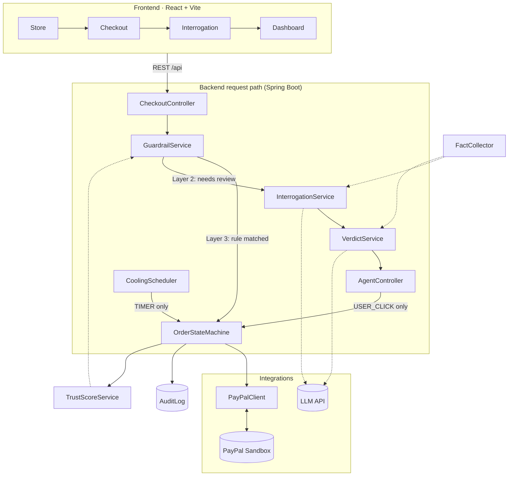

# Coolhead

**Buy with a cool head.** Coolhead sits on PayPal **authorize → capture**: checkout **holds** money instead of charging it, an agent asks short questions and applies hard rules, then **you** click. The LLM advises only — **USER_CLICK** or **TIMER** moves money, and the audit log proves it.

> **中文摘要：** 用 PayPal 授权冻结替代立即扣款；四层防护（授权 → 盘问 → 硬规则 → 信任分）；LLM 只出建议，扣款/解冻仅由用户点击或定时任务触发，全程可审计。

**Stack:** Spring Boot 3 · Java 21 · React · Vite · PayPal Orders (AUTHORIZE) · Gemini (OpenAI-compatible API)

---

## Links

| | |
| --- | --- |
| **Repository** | [github.com/rgtang/coolhead](https://github.com/rgtang/coolhead) |
| **Live demo** | [coolhead-1.onrender.com](https://coolhead-1.onrender.com/) |
| **Demo video** | [youtu.be/m6YAPBVEHU8](https://youtu.be/m6YAPBVEHU8) |
| **License** | [MIT](./LICENSE) (visible in repo About) |

Render free tier may **sleep** after idle time; first load can take ~30–60s.

---

## The problem

- Impulse buys often happen in one tap — after that, there is no structured pause or audit trail.
- PayPal can **authorize** first and **capture** later, but nothing helps the buyer decide *whether* to capture.
- Letting an LLM call `capture` directly turns safety into “please don’t” in a prompt — one injection away from failure.

## What Coolhead does

1. **Hold, don’t charge** — `intent=AUTHORIZE`; funds stay with the buyer until capture or void.
2. **Interrogation** — Up to 3 questions; server-supplied facts (spend, repeats, hour, trust) — no invented numbers.
3. **Guardrails (before any LLM)** — Whitelist `groceries` / `utilities`, auto-release under $20, forced 72h cool over $1000, trust ≥ 85 bypass.
4. **Trust score** — Per category 0–100; good decisions help, **Override** hurts; high trust can skip chat.

## Safety guarantee

- `OrderStateMachine` is the **only** place that changes order state or calls PayPal capture/void.
- Every money-moving audit entry has trigger **`USER_CLICK`** or **`TIMER`** — never the LLM.
- LLM down → fail-safe **COOL 24h**; doing nothing after cooling + grace → **TIMER** voids the hold (money stays with buyer).

---

## Quick start (judges, ~2 min)

No PayPal or LLM keys required — Docker only.

```bash
git clone https://github.com/rgtang/coolhead.git && cd coolhead
cp .env.example .env
docker compose -f docker-compose.yml -f docker-compose.judge.yml up --build
```

Open **http://localhost:5173**, then:

1. **Dashboard** — seeded history (`COOLHEAD_SEED=true` in judge compose): TIMER void, OVERRIDE, cancel after cooling, guardrail release; trust `gaming` 40, `electronics` 60.
2. **Weekly Grocery Box** → *Simulate PayPal approval* → **CAPTURED**, verdict shows `hard rule — no AI involved`.
3. **Next-gen Game Console** → Simulate → fail-safe **COOL 24h** without `LLM_API_KEY` → **Hold for 24h**.

Add `LLM_API_KEY` (Gemini) and PayPal Sandbox credentials to `.env` for full chat + real holds. See [Full setup](#full-setup) and [Demo script](#demo-script-2-min).

**Live site:** [coolhead-1.onrender.com](https://coolhead-1.onrender.com/) — behaviour depends on Render env vars (keys, `COOLHEAD_SEED`, CORS). For a controlled run, use Docker above.

---

## Demo script (~2 min)

1. **Store** → *Weekly Grocery Box* → whitelisted → instant capture; audit `GUARDRAIL` + `CAPTURED`.
2. *Smart Treadmill X* ($1299) → forced **72h** cool, no debate.
3. *Next-gen Game Console* → questions (if LLM configured) → verdict card → **Hold** → countdown.
4. **Override** with a reason → capture; trust for `gaming` −10.
5. **Dashboard** — stopped/captured totals, audit with `USER_CLICK` / `TIMER`, trust bars.

**TIMER without waiting hours:** shorten `coolhead.scheduler.scan-interval-ms` in `application.yml`, then in H2 (`http://localhost:8080/h2`, JDBC `jdbc:h2:mem:coolhead`, user `sa`):

```sql
UPDATE purchase_order SET cooling_until = NOW() - INTERVAL '1' HOUR WHERE state = 'COOLING';
UPDATE purchase_order SET reminded_at  = NOW() - INTERVAL '2' DAY  WHERE state = 'COOLING';
```

---

## Architecture

End-to-end: **Store → Checkout (PayPal authorize) → Guardrail or chat → Verdict card → user click → capture | cool | void.**



### Four layers

| Layer | What | Deterministic? |
| --- | --- | --- |
| 1 · Hold | PayPal `AUTHORIZE`, hold up to 29 days | yes |
| 2 · Interrogation | ≤3 questions, urgency vs real need | LLM |
| 3 · Guardrails | Whitelist, $20 / $1000 thresholds, trust ≥85 | yes |
| 4 · Trust | Category score feeds guardrails + LLM facts | yes |

### State machine

```
AUTHORIZED ──(RELEASE / guardrail / override)──▶ CAPTURED
    │
    ├──(COOL accepted)──▶ COOLING ──(confirm / override)──▶ CAPTURED
    │                        └──(cancel · TIMER after grace)──▶ VOIDED
    └──(BLOCK / cancel)──▶ VOIDED
```

Cooling hours from the LLM are clamped to **[1, 72]** in `OrderStateMachine`, not in the model output.

### Why we did not use [PayPal Agent Toolkit](https://github.com/paypal/agent-toolkit)

Toolkit = LLM **calls** PayPal tools (“pay for me”). Coolhead = LLM **never** gets capture/void; four fixed REST steps behind `OrderStateMachine` with auditable **USER_CLICK** / **TIMER** triggers. Toolkit fits optional future flows (e.g. draft refund), not the money path.

---

## Full setup

### Prerequisites

- **Docker** (recommended), or JDK 21 + Maven 3.9+ and Node 20+
- Optional: [PayPal Sandbox app](https://developer.paypal.com/dashboard/applications/sandbox), [Gemini API key](https://aistudio.google.com/apikey) (`LLM_*` in `.env.example`)

### Configure

```bash
cp .env.example .env
```

| Variable | If missing |
| --- | --- |
| PayPal creds | **Mock** PayPal + *Simulate PayPal approval* on checkout |
| `LLM_API_KEY` | Skip chat; fail-safe **COOL 24h** verdict |
| `COOLHEAD_SEED=true` | Preload 4 historical orders + audit + trust on empty DB |
| `VITE_PAYPAL_CLIENT_ID` (frontend) | Real PayPal button (must match backend sandbox app) |

### Docker (full stack)

```bash
docker compose up --build
# frontend http://localhost:5173   backend http://localhost:8080   (H2 /h2)
```

Compose sets `VITE_API_BASE=""` so nginx proxies `/api`. For local `npm run dev`, set `VITE_API_BASE` in `.env` if calling a remote API.

### Local dev

```bash
# backend (from backend/)
mvn spring-boot:run   # load ../.env in your shell or IDE

# frontend (from frontend/)
npm install && npm run dev   # proxies /api → localhost:8080
```

Windows: copy env vars from `.env` manually or use `--env-file` with Docker. Put `VITE_PAYPAL_CLIENT_ID` in `frontend/.env.local` for Sandbox buttons.

---

## API (summary)

| Method | Path | Moves money? |
| --- | --- | --- |
| GET | `/api/store/products` | – |
| POST | `/api/checkout`, `/api/checkout/{id}/authorize` | hold |
| GET/POST | `/api/agent/{orderId}/…` (message, verdict, accept, override, confirm, cancel) | on accept / override / confirm / cancel only (**USER_CLICK**) |
| GET | `/api/audit/*` | – |

**TIMER:** `CoolingScheduler` — `REMINDER` after cooling ends; **VOID** after `void-grace-hours` with no decision.

---

## Project layout

Single repo: `backend/` (Spring Boot, `PayPalClient`, agent, policy, audit, web), `frontend/` (Store, Checkout, Interrogation, Dashboard), `docker-compose.yml` + `docker-compose.judge.yml`, `.env.example`.

---

## License

[MIT](./LICENSE)
