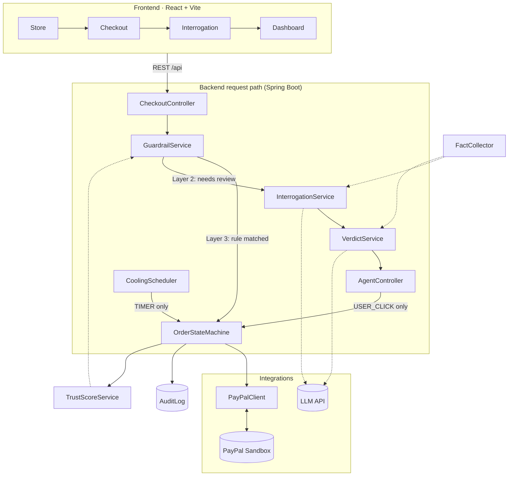

# Coolhead

**Buy with a cool head.** A purchase-cooling agent built on PayPal's *authorize → capture* flow.
When you check out, PayPal **holds** the money instead of charging it. Coolhead asks a few questions, computes hard facts
about your spending, and gives you a balanced verdict — then *you* click. The LLM never moves money; only your click or the
clock does, and the audit log proves it.

> Demo video: _TODO — add link_

---

## Architecture



### The four layers

| Layer | Where | What it does | Deterministic? |
| --- | --- | --- | --- |
| 1 · Hold, don't charge | `PayPalClient`, `CheckoutController` | Orders are created with `intent=AUTHORIZE`; funds are held up to 29 days, no capture until decided | yes |
| 2 · Interrogation | `InterrogationService`, `LlmConfig` | ≤3 short questions to separate real urgency from manufactured urgency | LLM |
| 3 · Guardrails | `GuardrailService` | Runs **before** any LLM call: whitelist categories, <$20 auto-release, >$1000 forced 72h cool, trust ≥85 bypass | yes |
| 4 · Trust score | `TrustScoreService` | Per-category 0–100; waiting/cancelling/accepting raises it, overriding lowers it; fed back into Layer 3 and the LLM | yes |

### State machine

```
AUTHORIZED ──(RELEASE accepted / guardrail / override)──▶ CAPTURED
    │
    ├──(COOL accepted)──▶ COOLING ──(confirm after timer / override)──▶ CAPTURED
    │                        │
    │                        └──(cancel · or TIMER after grace)──▶ VOIDED
    │
    └──(BLOCK accepted / cancel)──▶ VOIDED
```

`OrderStateMachine` is the only class that mutates `PurchaseOrder.state` or calls PayPal capture/void. Every transition
records an `AuditLog` whose `trigger` is `TIMER` or `USER_CLICK` — there is no LLM value in that enum, by design.
Cooling hours proposed by the LLM are clamped to `[1, 72]` here, not where they were proposed.
If the LLM is unreachable, `VerdictService` falls back to a 24h cool — failing safe keeps the money with the buyer.

### Why we did not use Agent Toolkit

[PayPal Agent Toolkit](https://github.com/paypal/agent-toolkit) exposes PayPal APIs (orders, payments, invoices…) as
tools an LLM can call. That is the right shape for "let the agent pay for me". Coolhead is the opposite: an agent that is
**not allowed to pay**.

- **The model must not hold the capture/void tools.** Our core guarantee is that money only moves on `USER_CLICK` or
  `TIMER`. Handing the LLM a `capture` tool turns that guarantee into "the prompt says it shouldn't" — one injected
  sentence in a product description or chat answer away from failing.
- **The money path is four fixed calls, not open-ended.** Create (AUTHORIZE) → authorize → capture | void, always in that
  order, gated by `OrderStateMachine`. A plain REST client (`PayPalClient`) is easier to audit than tool selection.
- **Determinism for the audit log.** Every PayPal call maps 1:1 to a state transition with a recorded trigger. With tool
  calling, "why did this capture happen?" would require replaying the model's reasoning.
- **Stack fit.** The toolkit targets TypeScript/Python agent frameworks; our backend is Spring Boot, and the LLM here only
  needs structured text output (questions, a `Verdict`), not tools.

The LLM still does what it is good at — asking questions and weighing reasons. Agent Toolkit would make sense for a
future, explicitly user-confirmed feature such as "draft a refund request", kept outside the capture path.

---

## Run it

### Prerequisites

- JDK 21 and Maven 3.9+ **or** Docker
- Node 20+
- (optional) PayPal Sandbox app credentials, a free [Google Gemini API key](https://aistudio.google.com/apikey)
  (any OpenAI-compatible provider works — set `LLM_BASE_URL` / `LLM_COMPLETIONS_PATH` / `LLM_MODEL`)

### 1. Configure

```bash
cp .env.example .env
# fill in PAYPAL_CLIENT_ID / PAYPAL_CLIENT_SECRET / LLM_API_KEY
```

Both integrations degrade gracefully:

| Missing | Behaviour |
| --- | --- |
| PayPal credentials | `PayPalClient` runs in **mock mode** (fake order/auth/capture ids, no network). Frontend shows a *Simulate PayPal approval* button. |
| `LLM_API_KEY` | No call to the LLM provider. Interrogation is skipped and `VerdictService` returns the fail-safe **COOL 24h** verdict immediately. |

Set `COOLHEAD_SEED=true` to start with history instead of an empty dashboard: 4 past orders from the last few days
(a headphones hold **voided by the TIMER**, a 1 a.m. console **OVERRIDE**, sneakers **cancelled after cooling**, a
whitelisted grocery capture), their full audit trail and transcripts, and trust scores `gaming 40`, `electronics 60`.
Seeded orders are all CAPTURED/VOIDED and use fake `SEED-*` PayPal ids, so they never trigger a real PayPal call.
Seeding is skipped if the database already has orders.

### 2a. One command (Docker)

```bash
docker compose up --build
# frontend  http://localhost:5173
# backend   http://localhost:8080   (H2 console at /h2)
```

Docker builds the frontend with `VITE_API_BASE=""` so the browser talks to `/api` on the same origin and nginx proxies
to the backend. The `VITE_API_BASE` line in `.env` is only for **local** `npm run dev`.

### Judges / zero-config (~2 min)

No PayPal or LLM keys required — only Docker.

```bash
git clone https://github.com/rgtang/coolhead.git && cd coolhead
cp .env.example .env
docker compose -f docker-compose.yml -f docker-compose.judge.yml up --build
# open http://localhost:5173
```

1. **Dashboard** — seeded audit trail, trust scores (`gaming` 40, `electronics` 60), and past orders.
2. **Weekly Grocery Box** → *Simulate PayPal approval* → **CAPTURED**, card shows `hard rule — no AI involved`.
3. **Next-gen Game Console** → Simulate → fail-safe **COOL 24h** (no API key) → **Hold for 24h** → **Dashboard** updates.

Add `LLM_API_KEY` and PayPal Sandbox credentials to `.env` for the full interrogation + real holds (see demo script below).

### 2b. Local dev

```bash
# backend
cd backend
export $(grep -v '^#' ../.env | xargs)      # PowerShell: Get-Content ../.env | % { if ($_ -match '^(\w+)=(.*)$') { [Environment]::SetEnvironmentVariable($matches[1], $matches[2]) } }
mvn spring-boot:run

# frontend (separate shell)
cd frontend
npm install
npm run dev                                  # proxies /api -> localhost:8080
```

Set `VITE_PAYPAL_CLIENT_ID` in `frontend/.env.local` to render real PayPal Sandbox buttons.

### 3. Demo script (~2 min)

1. **Store** → buy *Weekly Grocery Box* → whitelisted, captured instantly, audit shows `GUARDRAIL` + `CAPTURED`, no AI involved.
2. Buy *Smart Treadmill X* ($1299) → forced 72h hold, no debate.
3. Buy *Next-gen Game Console* → three questions → verdict card with *why buy / why wait* → accept the hold → countdown.
4. Hit **Override**, type a reason → captured, trust for `gaming` drops by 10.
5. **Dashboard** → "Stopped this month $X", full audit trail with `USER_CLICK`/`TIMER` triggers, trust bars.

To demo the **TIMER** path without waiting hours: lower `coolhead.scheduler.scan-interval-ms` (e.g. `5000`) in
`application.yml`, then backdate the row in the H2 console (`http://localhost:8080/h2`, JDBC URL `jdbc:h2:mem:coolhead`, user `sa`):

```sql
UPDATE purchase_order SET cooling_until = NOW() - INTERVAL '1' HOUR WHERE state = 'COOLING';   -- → REMINDER
UPDATE purchase_order SET reminded_at  = NOW() - INTERVAL '2' DAY  WHERE state = 'COOLING';   -- → auto VOID
```

---

## API

| Method | Path | Purpose | Moves money? |
| --- | --- | --- | --- |
| GET | `/api/store/products` | catalog | – |
| POST | `/api/checkout` `{productId}` | create PayPal order (AUTHORIZE) | – |
| POST | `/api/checkout/{paypalOrderId}/authorize` `{productId}` | hold funds, run guardrails, open interrogation | hold |
| GET | `/api/agent/{orderId}` | order + transcript + verdict | – |
| POST | `/api/agent/{orderId}/message` `{text}` | answer a question | – |
| POST | `/api/agent/{orderId}/verdict` | final LLM review (advice only) | – |
| POST | `/api/agent/{orderId}/accept` | act on the verdict | **USER_CLICK** |
| POST | `/api/agent/{orderId}/override` `{reason ≥10 chars}` | capture anyway, logged, trust −10 | **USER_CLICK** |
| POST | `/api/agent/{orderId}/confirm` | capture after cooling elapsed | **USER_CLICK** |
| POST | `/api/agent/{orderId}/cancel` | void the hold | **USER_CLICK** |
| GET | `/api/audit/logs` · `/stats` · `/trust` · `/orders` | dashboard data | – |

`CoolingScheduler` is the only other caller of the state machine (**TIMER**): reminder when cooling ends, void after the
grace period if nobody decided.

---

## Project layout

```
coolhead/
├── README.md · LICENSE (MIT) · .env.example · docker-compose.yml · docker-compose.judge.yml
├── backend/                         Spring Boot 3.5 · Java 21 · Spring AI 1.0 · H2
│   └── src/main/java/dev/you/coolhead/
│       ├── config/      PayPalProperties · PolicyProperties · LlmConfig (system prompts) · WebConfig
│       ├── paypal/      PayPalClient (+ mock mode) · dto/
│       ├── agent/       InterrogationService · VerdictService · Verdict · FactCollector
│       ├── order/       PurchaseOrder · OrderState · OrderStateMachine · CoolingScheduler · OrderRepository · ProductCatalog
│       ├── policy/      GuardrailService (L3) · TrustScoreService (L4)
│       ├── audit/       AuditLog (TIMER | USER_CLICK) · AuditService · AuditRepository
│       └── web/         StoreController · CheckoutController · AgentController · AuditController
└── frontend/                        React 18 · Vite · TypeScript · @paypal/react-paypal-js
    └── src/
        ├── pages/       Store · Checkout · Interrogation · Dashboard
        ├── components/  ProductCard · ChatBubble · VerdictCard · StatCard · Layout
        └── api/client.ts
```

## License

[MIT](./LICENSE)
